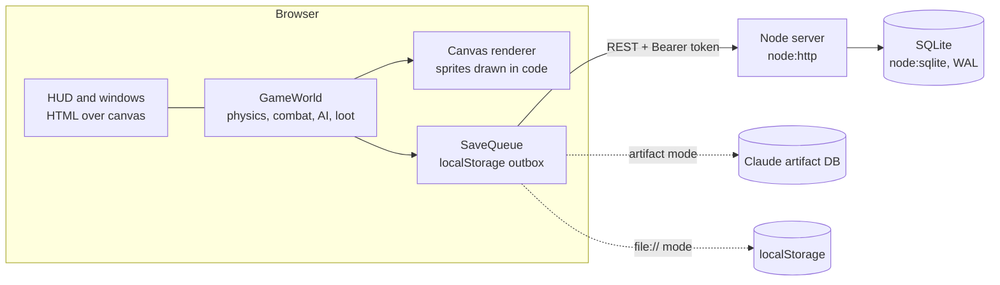

# Architecture and technical decisions

This document explains **how the game is built and why**. It covers the stack, the runtime picture, the decisions that shaped the code (with the trade-offs and when to revisit them), and the plan for multiplayer.

For setup and deployment see [README.md](../README.md). For content ids, conventions, traps and project history see [HANDOFF.md](../HANDOFF.md).

---

## 1. What runs where (today)

- **The whole game simulation runs in the browser**: movement, combat, monster AI, drops, quests, bots. The game loop has a fixed 1/60 s step (`main.js`).
- **The server is a thin persistence layer**: register/login, character list, save/load and a leaderboard. It validates saves for impossible values (`sanitizeCharacter`) but does not simulate anything.
- **One codebase, three storage backends** (`storage/storage.js`): the Node API with SQLite, the Claude artifact database, and browser localStorage. The game does not know which one it is using.
- **Shared rules**: `client/src/config.js` (tuning numbers) and `client/src/data/*` (content) are plain data modules. The server imports `config.js` directly, so class ids, equipment slots, level cap and point rules come from one place.

## 2. Stack

| Layer | Choice | Why | Trade-off / when to change |
|---|---|---|---|
| Client language | Plain JavaScript (ES modules), no framework | The game is a canvas, not a DOM app; React/Vue would only manage a few HUD windows. ES modules run in the browser as-is, so dev mode needs no build at all. | No static types (see §5). If the HUD grows into many complex screens, a small UI layer could help, but the canvas stays plain JS. |
| Rendering | Canvas 2D, every sprite drawn with curves at 3× and cached | No art assets to license or download; outfits and recolors are just data (`look` objects). | CPU-side drawing. Fine for this scale; a WebGL renderer (e.g. PixiJS) only if many players/particles on screen become slow. |
| Bundling | Custom `tools/build.mjs` (concatenates modules into one HTML file) | The game must also ship as a **single HTML file** (Claude artifact, open-from-disk). A tiny script did that with no toolchain. | It requires unique top-level names across modules and has no tree-shaking or source maps. **Vite + `vite-plugin-singlefile` is the natural replacement** once dependencies are allowed (§6). |
| Server | Node ≥ 22.13, `node:http` | Small API (8 routes); built-ins were enough and kept the image tiny. | Moving to Fastify or Express is cheap and sensible once WebSockets and more routes arrive. |
| Database | SQLite through `node:sqlite` (WAL mode) | One file, zero ops, transactional, fast for a few hundred players; easy backups: while the server runs, use `VACUUM INTO 'backup.db'` or SQLite's online backup API (not a plain file copy: in WAL mode recent writes live in `game.db-wal`); copying the file is only safe with the server stopped. | Single writer process. Move to PostgreSQL when running more than one server instance or needing managed backups/replicas. Note: `node:sqlite` still prints an "experimental" warning; `better-sqlite3` is the mature alternative. |
| Auth | scrypt password hashes + HMAC-signed tokens (`server/src/auth.js`) | No session store needed; works the same for REST and (later) WebSocket handshakes. | Tokens cannot be revoked one by one; rotate `TOKEN_SECRET` to log everyone out. Add refresh tokens/revocation only if needed. |
| Config | `client/src/config.js` (game tuning) + `.env` (deployment) | Balance changes in one file shared by client and server; secrets never in code. | — |
| Tests | Node's built-in runner (`node --test`): unit tests in `tests/unit`, end-to-end scenarios in `tests/e2e` driven by `playwright-core` | One language and one runner for everything; unit tests need no dependency at all; the e2e scenarios exercise the whole stack like a player | No HTML report/trace viewer like `@playwright/test`; switch to it if debugging failed scenarios gets painful |
| CI | GitHub Actions: secret scan → build → server smoke test → UAT | Catches leaked secrets, broken builds and gameplay regressions on every push. | — |
| Deploy | Docker image (non-root) or any Node host (Railway, Render, VPS) | One process, one volume for `data/`. | Needs a host with WebSocket support once multiplayer starts (all of these have it). |

## 3. Saving and the "queue"

The project has a **save queue, not a message broker**. It solves one problem: never lose loot when the network drops or the tab closes.

1. Every save is written **synchronously** to a localStorage **outbox** first, so it survives a crash, Alt+F4 or a lost connection.
2. It is then uploaded in the background. Only the newest snapshot is kept, at most one request is in flight, and failures retry with backoff (2 → 30 s) and again on the browser `online` event.
3. Rare drops trigger an immediate save. Closing the page also sends a `fetch(..., { keepalive: true })`.
4. On the next login, any outbox copy that is at least as far along as the server copy (by `playTime`) wins and is re-uploaded.

### Why not RabbitMQ, Kafka or Redis?

A message broker solves problems this game does not have yet:

| Tool | What it is for | Fit here |
|---|---|---|
| **RabbitMQ** | Work queues between services, routing, acknowledgements, retries | There is one service. The "queue" lives in the player's browser, because that is where the data is lost when the network drops. A broker on the server cannot help with that. |
| **Kafka** | High-throughput, durable, replayable event logs; many consumers; analytics pipelines | Massive overkill: it is built for millions of events per second across clusters, and it brings heavy operations work. |
| **Redis** (pub/sub, Streams) + **BullMQ** | Fan-out between several server processes; background jobs | **The first one worth adding**, and only when the game runs **more than one server process** (chat and presence must reach players connected to other instances), or when background jobs appear (daily resets, leaderboards, mail). |

**Rule of thumb for this project:** single process → in-memory structures. More than one process → Redis. Kafka or RabbitMQ only if the game becomes several services with real event-processing needs (analytics, anti-cheat pipelines). That is not on the roadmap.

## 4. Decisions log

Short ADR-style records. Add a new row (or a file under `docs/decisions/`) when a decision is expensive to reverse.

| # | Decision | Status | Why | Revisit when |
|---|---|---|---|---|
| 1 | Plain JS + canvas, no UI framework | Active | Canvas game; zero-build dev; single-file artifact build | HUD becomes a large app of its own |
| 2 | Simulation on the client, server only persists | Active (single-player) | Simple, offline-capable, no netcode | **Multiplayer stage 2** (server becomes authoritative) |
| 3 | SQLite as the only database | Active | Zero ops, one file | More than one server process, or managed backups needed |
| 4 | One monorepo (client + server + tools) | Active | One person, shared data and config, atomic changes | Separate teams/release cycles (unlikely) |
| 5 | Zero dependencies | **Superseded (2026-10-22)** by #6 | Started as a single-file artifact with no toolchain | — |
| 6 | **External libraries are allowed** | Active | Rewriting solved problems (WebSocket protocol, bundling, validation) costs more than a dependency | — |
| 7 | All tuning numbers in `config.js`, shared with the server | Active | One place to balance; client and server cannot disagree | — |
| 8 | Old saves migrate on load (`data/legacy.js`) instead of DB migrations for game ids | Active | Works for all three storage backends | A `saveVersion` field would make migrations explicit |
| 9 | Local outbox + background upload for saves (§3) | Active | Loot is never lost on disconnect or tab close | Multiplayer stage 2: the server saves, the outbox keeps only settings |
| 10 | E2E acceptance tests with pass/fail in CI | Active | Gameplay regressions show up on every push | — |
| 11 | Tests in JavaScript on `node --test` (+ `playwright-core` for e2e), replacing the earlier Python scripts | Active (2026-10-22) | Same language as the code, no Python toolchain, unit tests can import game modules directly | Move e2e to `@playwright/test` if traces/HTML reports are needed |

## 5. Dependency policy

External libraries are welcome when they replace code we would otherwise write and maintain ourselves. Guidelines:

- Prefer **small, widely used, maintained** packages; pin versions and commit `package-lock.json`.
- Note the reason for each new dependency in the decisions log (§4) or the PR description.
- Keep `client/src/config.js` and `client/src/data/*` **plain data** (no imports of browser or Node-only packages), because both sides import them.
- When the first runtime dependency is added, the Dockerfile must install it (`npm ci --omit=dev`); the current Dockerfile already does this automatically when a `package-lock.json` exists.

In use: `playwright-core` (dev only, e2e scenarios).

Likely next candidates:

| Need | Library | Why |
|---|---|---|
| WebSocket server (multiplayer) | `ws` | De-facto standard, tiny, battle-tested |
| Dev server + bundling | `vite` + `vite-plugin-singlefile` | Fast reload, source maps, tree-shaking; still produces the single-file artifact build; removes the unique-top-level-name constraint |
| Type safety | TypeScript (or JSDoc + `tsc --checkJs`) | The character object and network messages are the riskiest untyped shapes |
| Message validation | `zod` or `valibot` | Validate every client → server message once multiplayer starts |
| HTTP framework | `fastify` | Schema validation, plugins, WebSocket support (`@fastify/websocket`) |
| SQLite driver | `better-sqlite3` | Mature alternative to the still-experimental `node:sqlite` |
| Multi-process fan-out (later) | Redis + `ioredis` | Only when running more than one server process (§3) |

## 6. Multiplayer plan

| Stage | Scope | Server work | Notes |
|---|---|---|---|
| **1. Presence and chat** | See other players on the same map, real chat | WebSocket (`ws`) on the existing server, token auth at connect, one room per map, relay position/animation/look about 10×/s, chat with rate limits | Monsters stay per client ("parallel worlds"). Bots can stay to fill empty maps |
| **2. Shared, server-authoritative world** | Same monsters, bosses and loot for everyone | Move monster AI, damage, drops, EXP and quest progress into a module that runs on Node; per-map tick at 10–20 Hz; clients send intents ("cast skill D facing right"); server saves characters | Movement can stay client-side with server speed/position checks. Loot ownership rules. The save outbox then only stores settings |
| **3. Social** | Party (EXP share), trade, friends, guilds, real leaderboard, PvP later | Atomic server-side trades; party state | — |

Scale target: a single Node process + SQLite handles the first ~100 concurrent players. Add Redis (and move to PostgreSQL) only when a second process is needed.
